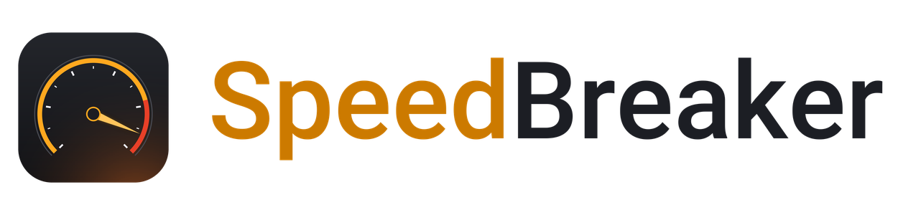
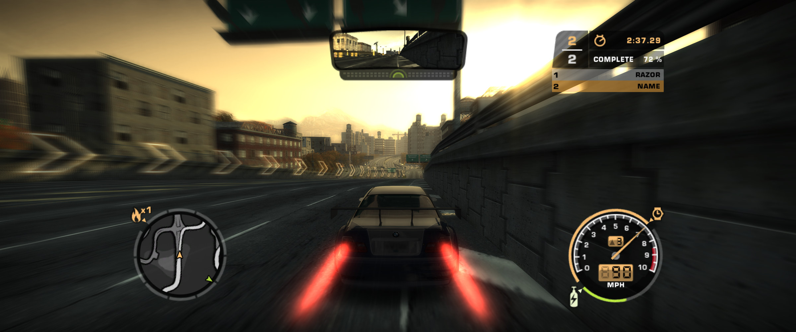
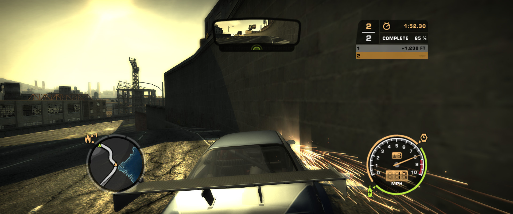
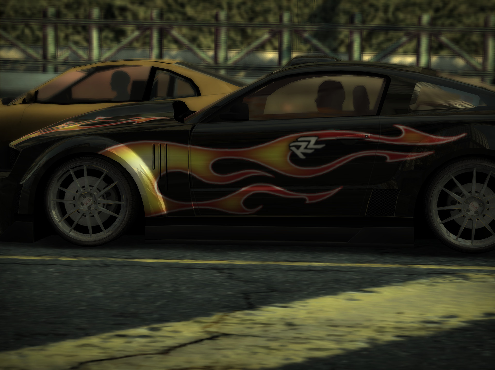
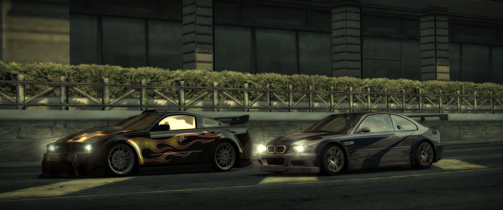
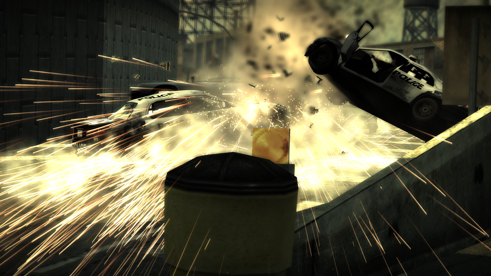
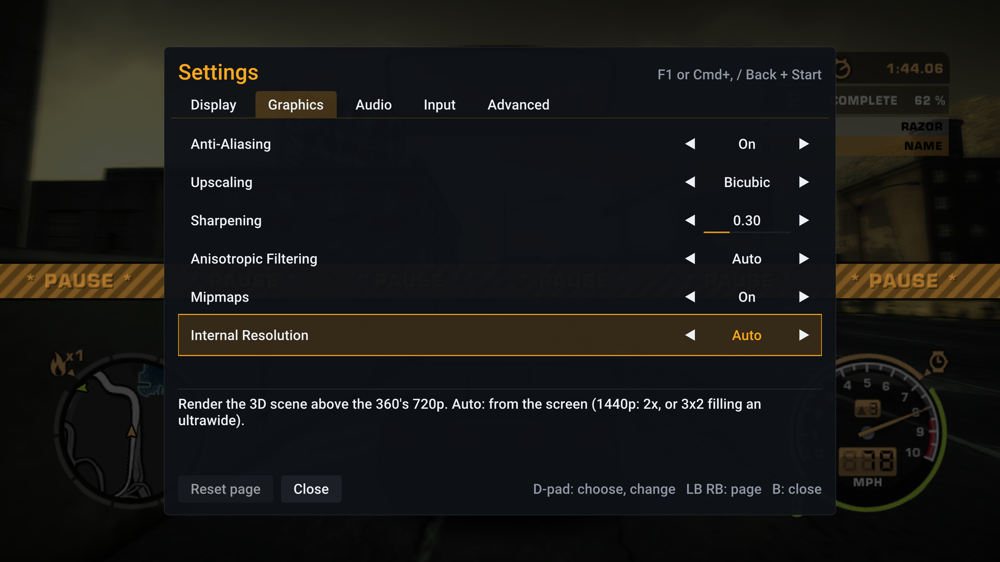
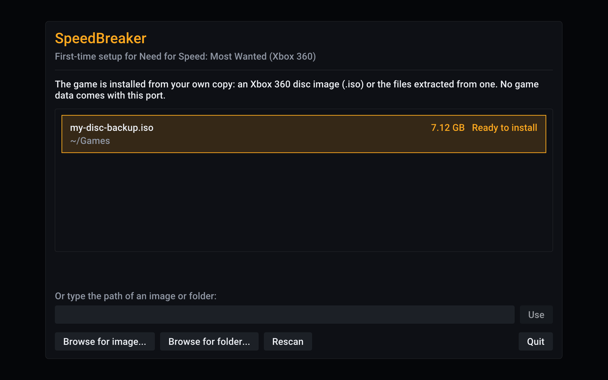
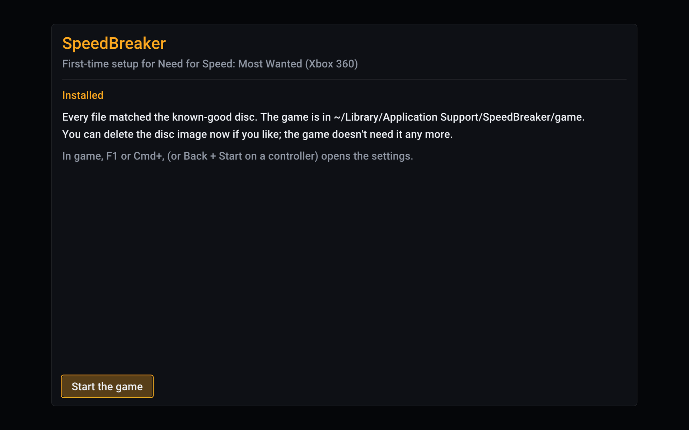

<p align="center">
  <picture>
    <source media="(prefers-color-scheme: dark)" srcset="assets/speedbreaker-banner-dark.png">
    
  </picture>
</p>

<p align="center">
  <b>An unofficial static recompilation of the Xbox 360 version of <i>Need for Speed: Most Wanted</i> (2005):<br>
  a native port, not an emulator.<br>
  Play your own copy on Steam Deck, Steam Machine and Steam Frame (SteamOS), Linux and Mac,<br>
  and for iPhone and iPad, sideload the experimental IPA or build it yourself.</b>
</p>

<p align="center">
  <a href="https://github.com/SpeedBreakerProject/speedbreaker/releases/latest"><b>Download</b></a>
  &nbsp;·&nbsp;
  <a href="#quick-start">Quick start</a>
  &nbsp;·&nbsp;
  <a href="https://projectugarte.com/speedbreaker/">Website</a>
  &nbsp;·&nbsp;
  <a href="#reporting-a-bug">Report a bug</a>
</p>

<p align="center">
  
  <br>
  <sub>What you see in a race, on a 21:9 ultrawide: a wider view, not a stretched one, with the HUD and the mirror where they belong.</sub>
</p>

> [!IMPORTANT]
> **SpeedBreaker is an unofficial fan project by project(u). It is not affiliated with, endorsed
> by or sponsored by Electronic Arts Inc., the Need for Speed brand or Valve Corporation.**
>
> **No game files are included or distributed.** To play, you need your own legally obtained
> backup (a disc image) of your own Xbox 360 disc of *Need for Speed: Most Wanted* (2005). The
> in-app installer verifies it and installs it. Please don't ask for, or share, game files or
> disc images. See the full [legal notice](#legal-notice).

**Contents:** [What it is](#what-is-speedbreaker) · [Highlights](#highlights) ·
[Download](#download) · [Quick start](#quick-start) · [How to update](#how-to-update) ·
[Setup by platform](#setup-by-platform) ·
[Controls](#controls) · [Settings](#settings) · [Tips](#tips-for-smooth-play) ·
[FAQ](#faq-and-troubleshooting) · [Known issues](#known-issues) · [What's next](#whats-next) ·
[For developers](#for-developers) · [Credits](#credits) · [License](#license) ·
[Legal notice](#legal-notice)

## What is SpeedBreaker?

SpeedBreaker is an unofficial static recompilation of the Xbox 360 version of *Need for Speed:
Most Wanted* (2005): a native port, not an emulator. It runs as an ordinary app on your device
(see [how it works](#how-it-works)).

It is built from the **Xbox 360 version** of the game, not the PC version: it runs the Xbox 360
release's own code, translated ahead of time, and it installs only from the Xbox 360 disc.

You bring the game: SpeedBreaker installs it from a backup of your own disc and checks every
file. Then you race, with things the Xbox 360 couldn't do: up to 4K, ultrawide and tall screens,
and a settings menu you can open mid-race.

## Highlights

- **Up to 4K.** The 3D scene renders at 1x, 1.5x, 2x or 3x the console's 720p (1.5x is 1080p,
  3x is 3840x2160). *Auto* picks a scale for your screen and device.
- **Ultrawide done right.** On 21:9 screens the view gets wider instead of stretched, and the
  HUD and the rear-view mirror stay in place. A 4:3 iPad, a 3:2 screen or the 16:10 screens of
  the Steam Deck and many Macs show more above and below instead, and fill the screen at their
  own resolution: a Steam Deck renders 1280x800 at 1x, pixel for pixel.
- **Up to 60 fps,** locked to your 60 Hz display. You can also pick a steady 30 at full game
  speed, or *Auto*, which drops to 30 only while a device is hot or can't hold 60. On a Mac with
  a 120 Hz screen, and on a SteamOS or Linux PC with a 120 Hz or 90 Hz one, *Smooth Motion* draws
  up to 120 fps (off by default; not on the Steam Deck).
- **Two-player split screen** (Quick Race > Split Screen), with two controllers.
- **USB steering wheels (experimental).** Tested with a Logitech G29 on a Mac, force feedback
  included; the steering feel is still being tuned.
- **Two discs: USA and European (PAL) Spanish.** One app plays either; the PAL disc brings its
  Spanish movies and police radio, and installs beside a USA install, each with its own saves.
- **Ten languages.** English, French, German, Italian, Spanish, Dutch, Swedish, Danish, Polish
  and Finnish, from the disc's own text (Settings > Game > Language). On the USA disc the movies
  and the speech stay in English; on the PAL disc they're Spanish.
- **The sun glare is back.** The low sun glows in open sky and fades behind buildings, as it did
  on the console.
- **The original look:** sunlit roads and shadows as on the console, the picture a real Xbox 360
  sends to a TV (the game's own display gamma), correct colours on Apple devices, proper car paint
  and mirror reflections, and distant textures that don't shimmer. Anti-aliasing, sharpening,
  FSR 1 upscaling, a Brightness setting and up to 16x anisotropic filtering are also available.
- **A guided installer.** It finds your disc image, checks that it is the right game, and
  verifies all 49 files as it copies them. An interrupted install never leaves a broken game.
- **Your controller, or the keyboard.** Controllers work as an Xbox 360 pad, with hot-plugging
  and rumble support. Every keyboard control can be reassigned in the settings.
- **A settings menu that pauses the game.** Open it with F1, Back + Start, or a three-finger
  tap. Every change applies at once, and *Quit Game* leaves the game from a controller too.
- **Suspend and resume on iPhone and iPad.** Switch away and the game freezes; come back and it
  carries on where it stopped.
- **One-button bug reports.** Logs, settings and a screenshot go into one zip file. Nothing is
  uploaded, and you decide what to send.
- **Check for Updates.** One press in the settings asks GitHub whether a newer release is out,
  shows what changed and opens the download page (or shows it as a QR code for your phone).
  Nothing is checked online unless you press Check for Updates.

<table>
  <tr>
    <td width="50%"><br><sub>21:9 in a race: the wider view and the low sun's glare.</sub></td>
    <td width="50%"><br><sub>4:3, the shape of an iPad screen, with more picture above and below.</sub></td>
  </tr>
  <tr>
    <td width="50%"><br><sub>The intro cinematic at 3440x1440.</sub></td>
    <td width="50%"><br><sub>A pursuit cinematic at 3840x2160.</sub></td>
  </tr>
  <tr>
    <td width="50%"><br><sub>The settings menu over a paused race.</sub></td>
    <td width="50%"><br><sub>First run: the installer has found the player's disc image.</sub></td>
  </tr>
</table>

<sub>Screenshots: SpeedBreaker v0.1.2 on a Mac Studio (M4 Max). They are unedited frames from the
game's own output, except that the licence plates in the top image and the first race image are
blurred. The game content in them
belongs to its owners.</sub>

## Download

| Platform | How to get it | Tested on |
|---|---|---|
| **Steam Deck** and **Steam Machine** (SteamOS) | [Download][dl-steamos-x86_64]<br>`SpeedBreaker-steamos-x86_64.tar.xz` | Steam Deck OLED (SteamOS 3.9.2). Steam Machine (SteamOS 3.8) on a 3440x1440 ultrawide. The Steam Deck LCD hasn't been tested yet. |
| **Steam Frame** (SteamOS, arm64) | [Download][dl-steamos-arm64]<br>`SpeedBreaker-steamos-arm64.tar.xz` | Steam Frame (SteamOS 0.3.0). It plays as a big flat screen in the headset; it is not a VR mode. |
| **Linux** (x86-64) | [Download][dl-steamos-x86_64] the x86-64 SteamOS build, `SpeedBreaker-steamos-x86_64.tar.xz`, or [build from source](#building-from-source) | Tested here on SteamOS. Players reported v0.1.1 working on Fedora 44 (GeForce GTX 1080 Ti) and Ubuntu 24.04 (Intel Arc 140T). Other setups: reports welcome. |
| **Mac** (Apple silicon) | [Download][dl-macos]<br>`SpeedBreaker-macos.dmg` | MacBook Pro (M1 Pro) on macOS 27 and Mac Studio (M4 Max) on macOS 26; macOS 15.6 (Sequoia) in a virtual machine. There is no Intel Mac build. |
| **iPhone** and **iPad** | [Sideload the IPA](#iphone-and-ipad) (experimental), `SpeedBreaker-<version>-ios.ipa` on the [release page][releases], or [build it yourself](#iphone-and-ipad) with Xcode | iPhone 15 Pro Max and iPhone 18 Pro Max (iOS 27). iPad Pro 12.9-inch (M2, iPadOS 27) with a Backbone Pro. Not on the App Store. Those were Xcode-signed builds: the IPA itself hasn't been installed on a device yet. |
| **Windows** (beta) | [Download][all-releases] `SpeedBreaker-0.2.0-windows-x64-beta.zip` from the Releases page; see [Windows (beta)](#windows-beta) | A laptop with Intel UHD Graphics (60 Hz). NVIDIA, AMD and recent Intel Arc graphics and 120/144 Hz monitors haven't been tested yet: [reports welcome](#reporting-a-bug). |
| **Android** | Coming soon | |

Each link downloads the newest release. Every file and its `.sha256` checksum file are on the
[latest release page][releases]. To check a download, put its `.sha256` file next to it and run
`shasum -a 256 -c SpeedBreaker-macos.dmg.sha256` on a Mac, or
`sha256sum -c SpeedBreaker-steamos-x86_64.tar.xz.sha256` on SteamOS (with your file's name): it
should say OK. What changed in each release is in [CHANGELOG.md](CHANGELOG.md).

### System requirements

- **Everyone:** a disc image of your own Xbox 360 disc, the **USA (NTSC-U)** release or the
  **European (PAL) release with Spanish movies and speech** (see
  [Quick start](#quick-start)), about **7.2 GB** of free space, and a display running at about
  **60 Hz** (or 120 Hz, 180 Hz or 240 Hz on SteamOS and Linux).
- **Split screen:** two controllers.
- **Smooth Motion** (up to 120 fps): a Mac with a 120 Hz screen (a ProMotion MacBook Pro or a
  120 Hz monitor), or a SteamOS or Linux PC (such as a Steam Machine) with a 120 Hz or 90 Hz
  screen. Not on the Steam Deck (it stays at a steady 60), nor yet on Windows, iPhone or iPad.
- **Steering wheels (experimental):** a USB wheel on a Mac, SteamOS or Linux. The Logitech G29
  is the one tested (on a Mac). Force feedback works on a Mac with the G29 in its PS3 position,
  the G27, G25, Driving Force GT and Pro; not yet a G29 in its PS4 position, a G920 or a G923,
  and it isn't tested on SteamOS or Linux.
- **Steam Deck, Steam Machine and Linux PCs** (the x86-64 SteamOS download): a 64-bit x86 CPU
  with AVX2 (x86-64-v3): Intel Haswell (2013) or newer, or AMD Excavator, Zen or newer. A
  Vulkan 1.2 graphics card.
- **Steam Frame** (the arm64 SteamOS download): SteamOS on the Steam Frame, kept up to date
  (v0.1.2 needs the September 2026 release or later). The arm64 download is for the Frame only;
  it hasn't been tested on any other arm64 Linux device.
- **Windows (beta):** Windows 10 or 11, 64-bit; a CPU with AVX2 (Intel Haswell from 2013 or
  newer, or any AMD Ryzen); a Vulkan 1.2 graphics card with a current driver.
- **Mac:** Apple silicon and **macOS 15** (Sequoia) or later. The app won't open on older
  versions of macOS, and there is no Intel Mac build.
- **iPhone and iPad:** iOS or iPadOS 17 or later, on an A15-class chip or newer (iPhone 13 and
  later, M-series iPads), and a controller or keyboard. Devices with less memory than the tested
  ones are untested.

## Quick start

1. **Back up your own disc.** SpeedBreaker supports two versions of the game: the **USA (NTSC-U,
   English) Xbox 360 disc** and the **European (PAL) disc with Spanish movies and speech**. The installer takes a full `.iso`, a trimmed XISO, or a folder with
   the extracted disc files. No title update is needed. SpeedBreaker doesn't provide game files
   or disc images, or link to them.
2. **Get SpeedBreaker.** [Download it](#download) for Steam Deck, Steam Machine and Steam Frame
   (SteamOS), Linux, Mac or Windows (beta). On iPhone and iPad you sideload the experimental IPA or build it
   yourself. Then follow the
   [setup for your platform](#setup-by-platform).
3. **Start it and install.** On first run, SpeedBreaker looks for your disc image, checks that
   it is the right game and version, then copies and verifies every file. This takes a few
   minutes at most. Afterwards you can delete the disc image.

   

4. **Race.** Your saves and settings are kept apart from the game, so they stay when you
   [update SpeedBreaker](#how-to-update) or reinstall the game. The settings open with **F1**, **Back + Start** on a
   controller, or a **three-finger tap** on iPhone and iPad.

### How to update

- **Mac:** drag the new SpeedBreaker into Applications, choose **Replace**, then allow it once more with **Open Anyway** (see [Mac setup](#mac)).
- **Steam Deck, Steam Machine, Steam Frame and Linux:** unpack the new download over the old folder (`~/Games/SpeedBreaker`); your Steam shortcut keeps working.
- **Windows (beta):** extract the new zip into a new folder, run it from there, then delete the old folder.
- **Everywhere:** your saves, settings and the installed game are kept, and no disc image is needed. Settings > Advanced > **Check for Updates** says when there's a new release, and so does GitHub's **Watch > Custom > Releases**.

## Setup by platform

### Steam Deck and Steam Machine

1. **Download and unpack** (in Desktop Mode). Download the SteamOS build,
   [`SpeedBreaker-steamos-x86_64.tar.xz`][dl-steamos-x86_64]. Make a `Games` folder in your home
   folder, move the file there, and choose *Extract archive here*. Or, in Konsole:

   ```sh
   mkdir -p ~/Games && tar -xf ~/Downloads/SpeedBreaker-steamos-x86_64.tar.xz -C ~/Games
   ```

   Keep it on internal storage or on an SD card formatted by SteamOS, and don't use `:`, `;` or
   `$` in the folder names. To update later, unpack the new download over the same folder
   ([How to update](#how-to-update)).

2. **Add it to Steam.** Steam > Games > *Add a Non-Steam Game to My Library* > Browse. Set the
   file type to *All Files* and pick `~/Games/SpeedBreaker/speedbreaker.sh`, the launcher (the
   program itself is in `lib/`). Leave *Compatibility* (Proton) off: this is a native Linux game.
3. **Put your disc image in Downloads,** or in the top folder of an SD card. SpeedBreaker also
   looks in your home folder, Desktop, Documents, Games, USB drives and EmuDeck's
   `Emulation/roms/xbox360`. Game Mode only sees SD cards and USB drives formatted by SteamOS;
   for a card formatted on a PC, copy the image into Downloads first.
4. **Install** (back in Game Mode). Start SpeedBreaker from your library. It highlights the image
   it found (*Ready to install*; with several, pick yours with Up and Down): press **A**, then
   **A** again on *Install*. Use the images it finds rather than *Browse for image...*, which may
   not open in Game Mode. The game goes to the internal storage; to put it on the SD card or in
   another folder, press Up and pick with Left and Right before *Install*. *Choose a folder...*
   opens a folder picker in Desktop Mode only. From Game Mode, switch to Desktop Mode and choose
   the folder there, or run `~/Games/SpeedBreaker/speedbreaker.sh --install <image> --dest <folder>`
   from Konsole in Desktop Mode (or over SSH). Use a folder on the internal storage or on a card
   formatted by SteamOS, or Game Mode won't find the game.
5. **Check the screen settings.**
   - **Steam Deck OLED: set the refresh rate to 60 Hz** (Quick Access > Performance). At 90 Hz
     the game stutters, and since v0.1.7 a note says so, once, the first time it runs at 90 Hz.
     Turn on Steam's per-game profile there and it keeps 60 Hz for this game. On any Deck, leave
     the Framerate Limit off.
   - **Docked, or on a Steam Machine:** in the shortcut's Properties > General > Game
     Resolution, choose **Native**.
   - The picture fills the Deck's 16:10 screen, with a slightly taller view and the HUD kept at
     16:9. For the console's 16:9 picture with thin bars above and below, set Settings > Display
     > Aspect Ratio to 16:9.

**Controls:** the Deck's controls work through Steam Input (default Gamepad layout).
**Settings:** hold **View** (two squares, left of the screen) and press **Menu** (three lines,
right of the screen).

**Uninstall:** delete `~/Games/SpeedBreaker/`, `~/.local/share/speedbreaker/` (this deletes your
saves too) and `~/.cache/speedbreaker/`, and remove the shortcut from Steam.

**Portable mode:** to keep everything in the SpeedBreaker folder (saves, settings, logs, shader
caches and the installed game), so the whole folder can be moved or copied to another Steam Deck,
Steam Machine or Linux PC, make an empty file named `portable.txt` next to `speedbreaker.sh`. That
starts fresh; to bring your current settings, saves and game along, run
`~/Games/SpeedBreaker/speedbreaker.sh --portable on` in Konsole instead, and `--portable off` to
go back. Both copy and never delete. The folder's README says more.

### Steam Frame

The Steam Frame has its own download. You set it up on the Frame's desktop: open the
**Desktop** app in your Steam library.

1. **Download and unpack.** Download the Steam Frame build,
   [`SpeedBreaker-steamos-arm64.tar.xz`][dl-steamos-arm64], into Downloads (not
   `SpeedBreaker-steamos-x86_64.tar.xz`: that one is for the Steam Deck, Steam Machine and Linux
   PCs). The Frame's file manager can't unpack it, so open **Konsole** and run:

   ```sh
   mkdir -p ~/Games && tar -xf ~/Downloads/SpeedBreaker-steamos-arm64.tar.xz -C ~/Games
   ```

   This makes `~/Games/SpeedBreaker`. Keep it on the Frame's internal storage, and don't use `:`,
   `;` or `$` in the folder names. To update later, unpack the new download over the same folder
   ([How to update](#how-to-update)).

2. **Add it to Steam.** In the file manager, open `~/Games/SpeedBreaker`, right-click
   `speedbreaker.sh` and choose *Add to Steam*. Or, in Konsole:
   `steamos-add-to-steam ~/Games/SpeedBreaker/speedbreaker.sh`. Leave *Compatibility* (Proton)
   off: this is a native Linux game.
3. **Put your disc image in Downloads.** SpeedBreaker also looks in your home folder, Desktop,
   Documents and Games.
4. **Install.** Start SpeedBreaker from your Steam library. It highlights the image it found
   (*Ready to install*): press **A**, then **A** again on *Install*. Or install
   from Konsole: `~/Games/SpeedBreaker/speedbreaker.sh --install ~/Downloads/your-image.iso`
   (with your image's name; add `--dest <folder>` to put the game in a folder of your choice).

SpeedBreaker plays as a big flat screen in the headset. It is not a VR mode.

- **Settings:** press **Menu + View** together.
- **Frame rate:** set **Display > Frame Rate** to **30 fps** for smooth play. In the headset,
  the VR compositor shares the graphics chip. The game keeps its full speed at 30.
- **Uninstall:** as on the [Steam Deck](#steam-deck-and-steam-machine).

### Linux

There's no separate desktop-Linux package yet. Try the x86-64 SteamOS download,
[`SpeedBreaker-steamos-x86_64.tar.xz`][dl-steamos-x86_64], which brings its own runtime libraries
and is tested here on SteamOS (players reported v0.1.1 working on Fedora 44 and Ubuntu 24.04), or
[build from source](#building-from-source). Unpack it,
put your `.iso` in your home folder, Downloads, Desktop, Documents or Games (or on a USB drive),
and run `speedbreaker.sh`: always start the game with it, since it picks the libraries the
program in `lib/` needs (started on its own, the program fails on most systems with a message
such as `GLIBC_2.44 not found`). The game starts in a window; Display > Fullscreen switches to full
screen and decides how the game starts. The installer puts the game in
`~/.local/share/speedbreaker/game`, or on a drive, or in any folder you pick with *Choose a
folder...* (it needs a file chooser portal or zenity; without one, use `--dest`, below).

On a laptop with two GPUs, SpeedBreaker uses the dedicated graphics card; with NVIDIA's driver the
launcher also turns on PRIME render offload. That hasn't been confirmed on a real two-GPU laptop
yet: the log's `[video] Vulkan devices:` line says which GPU it chose and why, and a report with
that line from yours would help. To pick another, start it with `NFSMW_GPU=<its number or part of
its name>`, e.g. `NFSMW_GPU=intel %command%` in Steam's launch options.

### Windows (beta)

The Windows version is a **beta**: so far it has been tested on one laptop with Intel UHD
Graphics and a 60 Hz screen. Download `SpeedBreaker-0.2.0-windows-x64-beta.zip` from the
[Releases page][all-releases], right-click it, choose **Extract All**, and double-click
`SpeedBreaker.exe` in the extracted folder (not inside the zip). SpeedBreaker isn't signed, so
Windows may say **"Windows protected your PC"**: click **More info**, then **Run anyway**.
(Smart App Control, where it's on, offers no Run anyway.) The installer then works as on the
other platforms: it looks for your `.iso` in your user folder, Downloads, Desktop, Documents and
Games and on your other drives, or takes one (or an extracted disc folder) you browse for, and
puts the game in `%LOCALAPPDATA%\SpeedBreaker`, where your saves, settings and logs go too.
`README.txt` in the zip has the details. **Check for Updates** isn't available on Windows yet.

Please [report](#reporting-a-bug) how it runs, especially on NVIDIA, AMD and Intel Arc
graphics and on 120 or 144 Hz monitors, with "Windows beta" in the issue's title. Windows
builds made by others aren't supported here.

### Mac

1. **Download and install.** Download [`SpeedBreaker-macos.dmg`][dl-macos], open it, and drag
   SpeedBreaker to your Applications folder.
2. **Open it.** The app isn't notarized by Apple, so the first time you open it, macOS refuses.
   Close that message (don't move the app to the Trash), then go to **System Settings > Privacy &
   Security**, scroll down to the message about SpeedBreaker, click **Open Anyway** and confirm.
   You only need to do this the first time you open a new download. On current macOS,
   Control-click > Open no longer skips this step.
3. **Put your disc image in a `Games` folder in your home folder** (`~/Games`). That's the only
   place SpeedBreaker looks by itself, so macOS doesn't have to ask for access to your other
   folders. For an image anywhere else, use *Browse for image...*.
4. **Install.** The game goes to `~/Library/Application Support/SpeedBreaker/game`, or to an
   external drive or any other folder if you choose one (*Choose a folder...*, with the arrows on
   the *To* row). An empty folder is used as it is; a folder that already holds files gets a new
   `SpeedBreaker Game` folder inside it. For a folder in Desktop, Documents or Downloads, or on an
   external drive, macOS asks once whether SpeedBreaker may use it: choose **Allow**. iCloud Drive
   can't hold the game (nor Desktop and Documents, if your Mac keeps them in iCloud): macOS would
   upload it and can remove its files from the Mac to save space.

**Settings:** **F1** or **Cmd+,**, or Back + Start on a controller. The game starts in a window;
Display > Fullscreen switches to full screen and decides how the game starts from then on. The
window's green button (or Ctrl+Cmd+F) switches only until you quit. In a window, the picture
runs up under a transparent title bar, and the window's buttons show while you move the mouse
over it. While you play, the mouse pointer hides after two seconds without moving. SpeedBreaker needs macOS 15 (Sequoia) or later.

### iPhone and iPad

SpeedBreaker isn't on the App Store. There are two ways to get it onto your iPhone or iPad:

- **Sideload the IPA (experimental).** Each release has an IPA, `SpeedBreaker-<version>-ios.ipa`,
  on the [release page][releases]. A sideloading tool such as AltStore signs it with your own Apple
  Account and installs it. The game asks iOS for more memory than most apps, and a free Apple
  Account can't give all of it, so with a free account it may not start, or iOS may close it in
  busy scenes. When iOS refuses the memory, the game says so on screen. The IPA itself hasn't been
  installed on a device yet (the tested iPhones and iPad ran the same app built and signed with
  Xcode): read [Sideloading the IPA](scripts/ios/README.md#sideloading-the-ipa-experimental)
  first, and please report how it goes, with your device and tool. Coming from a build you made
  yourself, the IPA installs as a separate app: install the game again from your disc image, and
  your saves stay with the old app.
- **Build it yourself** with Xcode on a Mac, signed with your own Apple developer account:
  [scripts/ios/README.md](scripts/ios/README.md) walks you through it.

Once SpeedBreaker is on your device:

1. **Get your disc image onto it.** Copy the `.iso` into **Files > On My iPhone (or iPad) >
   SpeedBreaker**, where it is found by itself. Or tap **Browse** and pick it from anywhere the
   Files app reaches, such as iCloud Drive or a USB drive. A browsed image is read where it is,
   not copied first.
2. **Install.** The game goes into the app's own storage, and is left out of iCloud and computer
   backups (your saves are still backed up). Afterwards you can delete the disc image.
3. **Connect a controller or a keyboard.** The game itself doesn't use touch. Pair a Bluetooth
   controller, such as an Xbox or PlayStation one, or use a Backbone. So far, a Backbone Pro on
   the iPad is the one tested.

**Settings:** tap with **three fingers**, or press Back + Start on the controller (View + Menu on
a Backbone). SpeedBreaker runs in landscape, full screen. If you switch away, the game freezes,
and it resumes exactly where it stopped. If 60 fps isn't steady on your iPhone, set Display >
Frame Rate to 30 fps or Auto.

## Controls

SpeedBreaker hands the game an Xbox 360 controller, so a race plays with the game's own Xbox 360
controls. Buttons are matched **by position**: on a PlayStation controller, Cross is A, Circle
is B, Square is X and Triangle is Y.

| Xbox 360 control | Controller | Keyboard |
|---|---|---|
| Left stick | Left stick | A / D or Left / Right steer; Up / Down push it up and down |
| Right trigger | Right trigger | W |
| Left trigger | Left trigger | S |
| A / B / X / Y | Bottom / right / left / top face button | Space / Backspace / Left Shift / Left Ctrl |
| LB / RB | Shoulder buttons | Q / E |
| D-pad | D-pad | Arrow keys |
| Start | Start / Menu / Options | Enter |
| Back | Back / View / Create | Esc |
| Right stick | Right stick | O / L up and down, K / ; left and right |
| Stick clicks | Press a stick in | Z (left), C (right) |

- One player, one controller: the first one connected is used, and you can plug one in at any
  time. The keyboard always works as well.
- **Split screen** (Quick Race > Split Screen): the second controller joins at "Player 2 press
  START" and drives the second half of the screen. If a player's controller disconnects, the
  game pauses and says so until it's back. It renders at most what Internal Resolution's Auto
  would for your screen, so it holds 60 fps; single player keeps your setting.
- **A steering wheel** (experimental) is used instead of a controller while both are plugged in:
  the wheel steers, the pedals are the throttle and the brake, the paddles shift gears, and the
  menus work from its D-pad, Cross (A) and Circle (B). On a G29, Share + Options opens the
  settings. See **Wheel** under [Settings](#settings).
- Because Back + Start opens the settings, the game sees Back a moment late: a tap arrives when
  you let go, a hold after a quarter of a second.
- The game shifts gears with the right stick, so from the keyboard you shift with O and L.
  Holding both keys of a pair centres the stick.
- Every keyboard control can be reassigned: **Settings > Controls** (F1). Each control has two
  keys: choose a row, Left or Right for its first or second key, press A or Enter, then the key
  you want (Esc or B cancels). Y or Backspace clears a key, X or Delete puts the row's defaults
  back, and *Reset page* restores this whole table. A key may drive several controls, as the
  arrows do. There is no mouse control in game.

**To open the settings:**

| Device | Open or close the settings |
|---|---|
| Keyboard | **F1** (on a Mac also **Cmd+,**) |
| Xbox-style controller | **Back + Start** (View + Menu) together |
| Logitech G29 wheel | **Share + Options** together |
| Steam Deck | Hold **View**, press **Menu** |
| Steam Frame | **Menu + View** together |
| iPhone and iPad touchscreen | **Three-finger tap** |

## Settings

The game pauses while the settings are open. The D-pad (or arrow keys) chooses and changes a row,
LB and RB (or Q and E) turn pages, and B (or Esc) closes the menu. On a touchscreen, tap and
drag. The mouse works too. Every change applies at once and is saved when you close the menu.
The bottom row has *Reset page* (the page's defaults), *Close*, and *Quit Game*, which asks
first, with *Cancel* chosen (not on iPhone and iPad, where apps are closed from the app
switcher).

<details>
<summary><b>All settings and their defaults</b></summary>

**Display**

| Option | Choices | Default |
|---|---|---|
| Fullscreen | On / Off | Off: a 1280x720 window you can resize. The game always starts as set here; on a Mac, the window's green button switches only until you quit, and the row then says NOW FULLSCREEN or NOW WINDOWED. Always on in SteamOS Game Mode. Not shown on iPhone and iPad, which are always full screen. |
| V-Sync | On / Off | On. Off can tear, but shows frames sooner. |
| Frame Rate | Auto / 60 fps / 30 fps | 60 fps on most devices. 30 fps keeps the game at full speed. Auto runs at 60, or at a steady 30 while the device is hot or can't hold 60. |
| Smooth Motion | On / Off | Off. On a Mac with a 120 Hz screen: up to 120 fps; on a SteamOS or Linux PC, 120 fps at 120 Hz and 90 at 90 Hz (it drops to an even 60 whenever pictures can't be shown on time; not on the Steam Deck). The game still runs at 60 steps a second, as on the console, and draws one more picture between each two; the controls answer a few milliseconds later. Heavy scenes ease off, down to an even 60 for a while. Takes effect the next time the game starts. Shown only where it works. |
| Screen Resolution | Full / 75% | Full. iPhone and iPad only: 75% is slightly softer and saves graphics work. |
| Aspect Ratio | Fill Screen / 16:9 | Fill Screen: wider screens get a wider view; 4:3, 3:2 and 16:10 screens (the Steam Deck, many Macs) a taller one. Since v0.1.9 the game renders the screen's own shape: a Steam Deck draws 1280x800 at 1x, a 1920x1200 screen 1920x1200 at 1.5x. 16:9 always shows the classic picture with bars. |
| Brightness | -5 to +5 | 0, the picture as it is. Each step makes the shadows and mid-tones a little lighter or darker, like a TV's brightness; black and white stay put, and the menus never change. |
| Xbox 360 Display Gamma | On / Off | On: the gamma ramp the game sets for a real Xbox 360's TV output, with slightly deeper shadows and slightly brighter mid-tones. Off: the flatter picture of v0.1.3 and earlier. |

The game's own Brightness slider, in the pause menu's Options > Video, works too while Xbox 360
Display Gamma is on (with it off, it does nothing). Its middle is the default look; Y (Defaults),
then Yes, puts it back.

**Graphics**

| Option | Choices | Default |
|---|---|---|
| Anti-Aliasing | On / Off | On |
| Upscaling | Bicubic / Bilinear / FSR 1 | Bicubic. FSR 1 (AMD FidelityFX Super Resolution 1) keeps curves, wires and diagonals smooth when the picture is enlarged a lot, such as 1x on a 1440p or 4K screen; it is used only when the picture is enlarged, costs a little more GPU time, and makes foliage look slightly painted. Not on iPhone and iPad. |
| Sharpening | 0.00 to 1.00 | 0.30 (0 turns it off). With FSR 1, the share of its sharpening pass's full strength. |
| Anisotropic Filtering | Auto / Off / 2x / 4x / 8x / 16x / Original | Auto: 16x on dedicated graphics cards and M-series iPads, 4x elsewhere. Original uses each texture's own setting, as on the 360. |
| Mipmaps | On / Off | On, so distant textures don't shimmer |
| Internal Resolution | Auto / 1x / 1.5x / 2x / 3x | Each entry shows the size it renders on your screen (1x (1280x720) on a 16:9 screen, 1x (1280x800) on a Steam Deck with Fill Screen), and Auto the one it picked. Auto: enough to cover your screen, within what the device can afford: the screen's own shape when that fits (a Steam Deck's 1280x800), otherwise whole scales (1x, 2x, 3x, or 3x2 on an ultrawide). On iPhone and iPad, Auto always picks 1x. With Fill Screen, the rows count the screen's shape: 1x on a 16:10 screen is 1280x800. |

**Game:** Language (English): French, German, Italian, Spanish, Dutch, Swedish, Danish, Polish or
Finnish switch the menus and the race text (European languages show km/h) the next time the game
starts. The text comes from the disc's own files; the movies and the speech stay in the disc's
language (English on the USA disc, Spanish on the PAL one). The PAL disc starts in Spanish.
The line under the row says what your installed files give the language you choose. Not shown on
iPhone and iPad.

**Audio:** Master Volume (100%), Mute (Off), and Mute in Background (Off), which silences the
game while its window isn't in front.

**Input:** Stick Deadzone (8%; raise it if the car steers by itself), Trigger Deadzone (2%), and
Vibration (On).

**Wheel** (experimental; shown while a steering wheel is plugged in): Steering Wheel (On; Off
lets a controller or the keyboard play while the wheel stays plugged in), Steering Range (360
degrees lock to lock, of a G29's 900), Invert Steering, Steering Deadzone (0%), Steering Response
(1.00), Force Feedback (100%), Centering Force, and **Calibrate**, which teaches the game a wheel
other than the G29: both ends of its turn, each pedal, then a button for each control.

**Controls:** the keyboard keys for each Xbox 360 control, two per control, as in the table under
[Controls](#controls). The keys are saved by name in `settings.toml`'s `[keys]` table (`w`,
`left_shift`, `keypad_1`, or `none`; `runtime/user/key_names.h` lists them).

**Advanced:** Asynchronous Shaders (On: an object is skipped for a frame or two while its shader
compiles, instead of the game stuttering), Performance Overlay (Off: fps, frame times, and CPU
and GPU time per frame), **Save Bug Report**, and **Check for Updates** (the only thing that goes
online, and only when you press it). The page also shows which build you're running.

</details>

## Tips for smooth play

- **Run your display at 60 Hz.** On a Steam Deck OLED, set the refresh rate to 60 Hz and leave
  Steam's Framerate Limit off.
- **A 120 Hz monitor works too** on SteamOS and Linux (and 180 or 240 Hz): since v0.1.7 each frame
  stays on screen for two refreshes (three or four), evenly. That was tested on simulated 120,
  180 and 240 Hz screens, not yet on a real one: a report from yours would help. 90, 144 and
  165 Hz can't show 60 fps evenly; the game says so once, and 60 or 120 Hz (or variable refresh)
  is smooth.
- **MacBook Pro with a 120 Hz (ProMotion) screen:** since v0.1.4 SpeedBreaker asks for each frame
  to reach the screen 1/60 s after the last. Measured in fullscreen on an M1 Pro: 99.9% of frames
  in menus and about 94% while driving (fewer in the heaviest scenes). Other screens show frames
  as before. Since v0.1.8, **Smooth Motion** (Settings > Display) draws up to 120 fps there;
  Internal Resolution's Auto picks for it (1x on an M1 Pro).
- **Start with Auto.** If busy scenes drop below 60, set Internal Resolution one step lower, or
  let Frame Rate *Auto* fall back to a steady 30.
- **30 fps is a real option.** It's a steady 30 at full game speed, and the smooth choice in the
  Steam Frame headset.
- **Between 1x and 2x,** try 1.5x (1080p): much sharper than 1x, with a little over half the
  pixels of 2x.
- **On iPhone and iPad,** keep Internal Resolution at Auto (1x). On the tested iPad Pro (M2), 2x
  is too slow for races. The iPhone 18 Pro Max holds 60 fps at 1.5x, but on a cable it reached
  iOS's "serious" heat level in about nine minutes (1x did in about six), and Frame Rate Auto then
  drops to 30. Screen Resolution 75% saves more.
- **Docked Deck or Steam Machine:** set the shortcut's Game Resolution to Native.
- **See what's happening:** Settings > Advanced > Performance Overlay.

## FAQ and troubleshooting

**Does SpeedBreaker include the game?**
No. No game files are included or distributed. You install the game from your own backup of
your own disc, and SpeedBreaker checks it file by file.

**Which version of the game do I need?**
The Xbox 360 **USA release (NTSC-U, English)** or the **European (PAL) release with Spanish
movies and speech** (since v0.2.0). The installer checks your image and tells you which one it
found, or that it's a different version. Other PAL discs (German and the rest), Japanese discs and
re-releases have different code, so the installer refuses them for now. Installing one disc
beside the other keeps both installs. Both discs hold the game's text in ten languages: pick one
in Settings > Game > Language. Games on Demand packages aren't supported, and no title update is
used.

**Does it work with the PC version of the game?**
No. SpeedBreaker is built from the Xbox 360 version and installs only from the Xbox 360 USA or
European (PAL) Spanish disc.
PC copies of *Most Wanted*, including the Black Edition, aren't supported.

**Is this an emulator?**
No. It's a static recompilation: the game's Xbox 360 code was translated ahead of time into a
native app, so that code runs directly instead of being emulated. SpeedBreaker supplies what the
game expects from the Xbox 360: its system software, graphics, audio and controllers.

**Can it run above 60 fps?**
No. 60 fps is the game's own cap.

**Can I bring my Xbox 360 saves?**
No. Xbox 360 saves can't be imported, so your career starts fresh.

**The installer refused my image. Why?**
It always says what to do. The usual causes:

- *Another game, or an unsupported version:* it isn't the USA or the European (PAL) Spanish disc.
- *Truncated image:* most often a copy cut off at 4 GB by a FAT32 drive. Copy it again from your
  own backup, onto a drive that can hold files over 4 GB.
- *Not a disc image,* a Games on Demand package, or a video-only DVD image.
- *Missing or corrupt files:* make a new backup from your disc.

**My Mac says SpeedBreaker can't be opened.** Use **Open Anyway** in System Settings > Privacy &
Security (see [Mac setup](#mac)), again after each update. SpeedBreaker needs macOS 15 (Sequoia)
or later on Apple silicon.

**The game stutters on my Steam Deck OLED.** Set the screen to 60 Hz (see
[Steam Deck setup](#steam-deck-and-steam-machine)); with Steam's per-game profile on, it stays at
60 Hz for this game.

**My laptop runs the game on the slow built-in graphics.** Since v0.1.2 SpeedBreaker is meant to
pick the dedicated GPU by itself (not yet confirmed on a real two-GPU laptop). If it doesn't, see
the `[video] Vulkan devices:` line in `last-run.log`, set `NFSMW_GPU` (see [Linux](#linux)), and
please open an issue with that line.

**The picture is small or stretched on my TV or monitor in Game Mode.** Set the shortcut's
Properties > General > Game Resolution to Native.

**Can I have the bars back on my Deck?** Yes. The game is 16:9 and the Deck's screen 16:10, and
since v0.1.1 the picture fills it with a slightly taller view. Set Settings > Display > Aspect
Ratio to 16:9 for the console's picture with thin bars above and below.

**My SD card or USB drive doesn't show up in Game Mode.** Game Mode only sees drives formatted by
SteamOS. Copy the image into Downloads from Desktop Mode.

**Can I install the game somewhere other than the default folder?** Yes. On the installer's last
page, choose where it goes on the *To* row: internal storage, a removable drive, or *Choose a
folder...* for any folder (SteamOS: in Desktop Mode). An empty folder is used as it is; a folder
that already holds files gets a new `SpeedBreaker Game` folder inside it, and the top of a drive
gets the drive's own `speedbreaker/game` (`SpeedBreaker/game` on a Mac). Or install from a
terminal with `--dest` (see [Command-line installer](#command-line-installer)). SpeedBreaker
remembers the place; if it's on a drive that isn't connected when the game starts, the installer
says so: connect it and start the game again.

**The car steers by itself.** Raise Settings > Input > Stick Deadzone.

**The picture looks different since v0.1.4.** v0.1.4 applies the gamma ramp the game sets for a
real Xbox 360's TV output: slightly deeper shadows and slightly brighter mid-tones, as on the
console. For the previous, flatter picture, turn off Settings > Display > Xbox 360 Display Gamma.
For lighter or darker shadows either way, use Settings > Display > Brightness. If the picture is
much brighter and washed out, the game's own Brightness slider (pause menu > Options > Video) was
probably moved up in an earlier version, where it did nothing, and saved: it now takes effect. Set
the slider back to the middle, or press Y (Defaults) and choose Yes.

**How do I quit in fullscreen without a keyboard?** Open the settings and choose *Quit Game* on
the bottom row; it asks first.

**The game ignores my touches on iPhone or iPad.** The game needs a controller or a keyboard.
Touch only works in SpeedBreaker's own screens; a three-finger tap opens the settings.

**Where are my saves, settings and logs?**

| | Linux and SteamOS | Mac | iPhone and iPad |
|---|---|---|---|
| Saves, settings, logs | `~/.local/share/speedbreaker/` | `~/Library/Application Support/SpeedBreaker/` | Inside the app (not shown in the Files app) |
| Installed game | `game/` in that folder, `speedbreaker/game` on a drive, or the folder you chose | `game/` in that folder, `SpeedBreaker/game` on a drive, or the folder you chose | Inside the app |
| Shader caches (safe to delete) | `~/.cache/speedbreaker/` | `~/Library/Caches/SpeedBreaker/` | Inside the app |

Deleting that folder, or deleting the iPhone or iPad app, deletes your saves. A game you
installed in a folder of your own stays there until you delete that folder. In
[portable mode](#steam-deck-and-steam-machine) (SteamOS and Linux) all of it is in the
SpeedBreaker folder instead: `data/`, `data/game` and `cache/`.

### Reporting a bug

1. Open the settings, go to **Advanced**, and choose **Save Bug Report**.
2. A notice says where the zip file went: your **Desktop** (on SteamOS, pick it up in Desktop
   Mode, or in the Desktop app on a Steam Frame), the **SpeedBreaker** folder in the Files app on
   iPhone and iPad, or the data folder above when there is no Desktop. Its name says which
   version you were running, for example `speedbreaker-bug-report-v0.2.0-<date>_<time>.zip`.
3. Open an [issue][issues], attach the zip, and say what you were doing, what you expected, what
   happened, and roughly how long into the session it happened.

The zip holds recent logs, any crash and hang reports, your settings, a summary of your system
and a screenshot of the last game frame. Paths in your home folder show as `~`. If the game
crashed, start it again and save a report: the crash report is included. **Never attach game
files or disc images to an issue.** [CONTRIBUTING.md](CONTRIBUTING.md) says how bug reports and
pull requests are handled.

## Known issues

- **Mac: wired Xbox controllers don't rumble.** macOS drives an Xbox One or Series controller
  connected by USB through its own controller framework, which never runs the motors. Pair it
  over Bluetooth for rumble (a DualSense rumbles either way). The game says so once.
- **Languages:** the movies and the speech (the police radio, the voices in the scenes) stay in
  the disc's language in every language: English on the USA disc, Spanish on the PAL one. Fan
  translations aren't supported.
- **Discs:** only the USA and the European (PAL) Spanish discs install; German and the other PAL
  discs are still to come.
- **Smooth Motion on SteamOS and Linux:** offered only at 120 Hz and 90 Hz, and not on the Steam
  Deck, where busy scenes can't keep up and it would ghost.
- **Steering wheels are experimental:** the steering feel is still being tuned; see
  [Settings](#settings).

## What's next

- **Windows:** in [beta](#windows-beta) now; a full release once it has run on more PCs.
- **Android:** coming soon.

**One more thing… SpeedBreaker: Carbon, coming soon.** It's planned, not available yet.

There are no dates and no promises: it's ready when it's ready.

## For developers

### How it works

SpeedBreaker is a **static recompilation**. [XenonRecomp](https://github.com/hedge-dev/XenonRecomp)
translates the game's PowerPC code into C++ ahead of time, and that C++ is compiled into a
native program for x86-64 or arm64. A runtime written for this project stands in for the Xbox
360: its kernel and system software, its GPU, its XMA audio and its controllers.

- **Graphics:** a Vulkan renderer that translates the Xenos GPU's commands and shaders. On Mac,
  iPhone and iPad it runs on Metal through MoltenVK.
- **Platform layer:** SDL3 for windows, input and audio. The installer, the settings menu and the
  overlay are drawn with Dear ImGui.
- **Audio:** XMA decoding done the way the hardware does it, frame by frame, with a patched,
  decoder-only FFmpeg.
- **Resolution:** the 3D scene renders at 1x, 1.5x, 2x or 3x; the bloom and haze stay at the original
  resolution, so the game keeps its colour grade.
- **Frame pacing:** the game's clock locks to the display's measured refresh (58.5 to 61.5 Hz),
  one game step per refresh, or on SteamOS and Linux to every 2nd, 3rd or 4th refresh of a 120,
  180 or 240 Hz display. 30 fps runs two game steps per frame. On a Mac the clock's thread
  runs with real-time priority, and on a 120 Hz ProMotion screen each frame is shown at a set time
  after its tick (turned off for the session if the screen doesn't keep those times).
- **Sun glare:** the game measures the sun with occlusion queries; SpeedBreaker counts them on
  the GPU.

The game's data (cars, city, audio, movies) comes from the player's disc. SpeedBreaker contains
no game data or assets.

### Command-line installer

The installer also runs from a terminal. On SteamOS and Linux, run it through `speedbreaker.sh`
(`~/Games/SpeedBreaker/speedbreaker.sh --install ...`); on a Mac, the program is
`SpeedBreaker.app/Contents/MacOS/SpeedBreaker`.

```sh
SpeedBreaker --install <image or folder> [--dest <dir>]   # install (into exactly <dir>, if given)
SpeedBreaker --verify <image or folder>                   # check every file without copying
SpeedBreaker --find-images                                # list the disc images it can find
SpeedBreaker --where                                      # show where the game is installed
speedbreaker.sh --portable on|off                         # SteamOS and Linux: portable mode (copies, never deletes)
```

Without `--dest` the game goes to the default folder, as from the installer screen. `--dest`
installs into exactly that folder, which must be new, empty or hold a previous install (not a
temporary folder kept in memory, such as `/tmp` on SteamOS); the game remembers it.

### Building from source

The repository contains no game code: the build recompiles your own `default.xex`, from the USA
disc. The generated code (`ppc/`), the game files (`game/`) and the toolchain (`tools/`) are
ignored by git. **Never commit or share them.**

The supported executable is 3,936,256 bytes, with SHA-256
`aebdf3c14d1e4e4ed2c130d94bc1a0e97bd6d5bf39bdfdef33c3909c9cc4ba4c`.

#### 1. Dependencies

- **Mac:** Xcode's command-line tools, and from Homebrew: `brew install llvm lld cmake ninja
  molten-vk`. The libraries the app bundles (SDL3, the Vulkan loader, glslang, SPIRV-Tools and
  FFmpeg's XMA decoder) are built from their own source releases by
  `scripts/macos/build_deps.sh`, for macOS 15 like the release (step 3). Homebrew's bottles of
  them (`brew install sdl3 vulkan-loader vulkan-headers glslang spirv-tools`) also work, for an
  app that runs only on the macOS you build on (step 3).
- **SteamOS:** build inside an Arch Linux distrobox (podman and distrobox ship with SteamOS). The
  development launcher, `scripts/steamos/speedbreaker.sh`, expects the container to be called
  `nfsmw-build`:

  ```sh
  distrobox create --yes --name nfsmw-build --image docker.io/library/archlinux:latest \
    --additional-packages "clang lld cmake ninja git python sdl3 vulkan-headers \
      vulkan-icd-loader vulkan-tools glslang spirv-tools mesa vulkan-radeon pkgconf \
      make diffutils patch curl nasm libpulse pipewire pipewire-pulse alsa-lib libdecor"
  distrobox enter nfsmw-build
  ```

- **Other Linux distributions:** your distribution's equivalents of the package list above
  (Clang 18 or newer). Untested so far. The GPU needs Vulkan 1.2 and BC (DXT) texture support.
- **Windows (beta):** the Visual Studio Build Tools (MSVC's libraries, the Windows SDK) with
  LLVM's `clang-cl` 19 or newer, CMake and Ninja, and SDL3, glslang and FFmpeg's XMA decoder built
  as static libraries with the static C runtime (`/MT`) into one folder. FFmpeg's configure
  options are `scripts/build_ffmpeg_xma.sh`'s, with FFmpeg's MSVC toolchain; the Windows
  third-party source archive on the release page has the exact build script. Step 2 runs on a
  Mac or Linux; copy `ppc/` and `tools/XenonRecomp` to the Windows PC.
- `gh`, logged in, is optional: it fetches Xenia's instruction tests.

#### 2. Toolchain, your game files, recompilation

From the repository root:

```sh
scripts/setup_tools.sh    # XenonRecomp + SpeedBreaker's patches, extract-xiso, FFmpeg's XMA decoder

# Extract your own disc image into game/files and check the executable.
mkdir -p game/files
tools/extract-xiso/build/extract-xiso -d game/files -x /path/to/your-backup.iso
shasum -a 256 game/files/default.xex
# must print aebdf3c14d1e4e4ed2c130d94bc1a0e97bd6d5bf39bdfdef33c3909c9cc4ba4c

# Translate the game's code into C++ (writes ppc/).
mkdir -p ppc
tools/XenonRecomp/build/XenonRecomp/XenonRecomp config/nfsmw.toml tools/XenonRecomp/XenonUtils/ppc_context.h

# Optional, for the European (PAL) Spanish disc too: its own code, beside the USA's (the build
# links it when ppc-pal-es/ is there; -DSB_PAL_ES=OFF leaves it out and refuses that disc).
mkdir -p game/files-pal-es ppc-pal-es
tools/extract-xiso/build/extract-xiso -d game/files-pal-es -x /path/to/your-pal-backup.iso
shasum -a 256 game/files-pal-es/default.xex
# must print aad15fc218d034de3131f746e0b763dd8049a40dd676efc87667fcaf4fc72694
tools/XenonRecomp/build/XenonRecomp/XenonRecomp config/pal-es/nfsmw.toml tools/XenonRecomp/XenonUtils/ppc_context.h
python3 scripts/region_ppc.py ppc-pal-es pal_es
```

#### 3. Build

```sh
# Linux and SteamOS (on SteamOS, inside the container)
cmake -S . -B build/main -G Ninja -DCMAKE_BUILD_TYPE=Release \
  -DCMAKE_C_COMPILER=clang -DCMAKE_CXX_COMPILER=clang++

# Mac (Homebrew's LLVM): the libraries for macOS 15, as the release (a few minutes; it downloads
# their source archives and checks each one's SHA-256), then the game against them
scripts/macos/build_deps.sh build/deps
cmake -S . -B build/main -G Ninja -DCMAKE_BUILD_TYPE=Release \
  -DCMAKE_C_COMPILER=/opt/homebrew/opt/llvm/bin/clang \
  -DCMAKE_CXX_COMPILER=/opt/homebrew/opt/llvm/bin/clang++ \
  -DCMAKE_PREFIX_PATH="$PWD/build/deps" -DFFMPEG_XMA="$PWD/build/deps/ffmpeg-xma"
# (or, with Homebrew's libraries instead of build_deps.sh, an app for your own macOS only: the
#  same cmake line with -DCMAKE_OSX_DEPLOYMENT_TARGET=<your macOS, e.g. 26.0> instead of the last
#  two options; make_app.py names the version if it's wrong)

ninja -C build/main SpeedBreaker
```

On Windows (beta), from an x64 Visual Studio developer prompt with `clang-cl` on `PATH`:

```bat
cmake -S . --preset windows-clang -DCMAKE_PREFIX_PATH=<deps folder> -DFFMPEG_XMA=<deps folder>
ninja -C build\windows SpeedBreaker
```

`--preset windows-clang-tester` instead links it without a console window and labels it, as the
download is; `python scripts\windows\make_zip.py --public ...` (its header lists the options)
packages it with the license notices.

Run `build/main/runtime/SpeedBreaker` from the repository root. With the whole disc extracted in
`game/files`, it plays from there. Otherwise the first-run installer asks for your disc image.

#### 4. Package it (optional)

- **Mac app:** `python3 scripts/macos/make_app.py` makes `build/app/SpeedBreaker.app`, with its
  libraries, MoltenVK and the license notices inside. It refuses a library built for a newer
  macOS than the build (and says how to fix it); `python3 scripts/macos/check_app.py
  build/app/SpeedBreaker.app` runs the release's checks. Add `--dmg` for
  `build/app/SpeedBreaker-macos.dmg` and its `.sha256`, laid out like the download on Releases.
- **SteamOS bundle (x86-64):** inside the container, `scripts/steamos/make_bundle.sh` makes
  `build/bundle/SpeedBreaker-steamos-x86_64.tar.xz` and its `.sha256` (plus a copy named by the
  version, `SpeedBreaker-<version>-steamos-x86_64.tar.xz`): `speedbreaker.sh` at the top, the
  program and its libraries in `lib/`. Install it as described in
  [Steam Deck setup](#steam-deck-and-steam-machine).
- **Steam Frame bundle (arm64):** the Steam Frame download on Releases is built on a Frame, and
  so is your own: the Frame's SteamOS ships clang, CMake, Ninja, glslang and the Vulkan headers,
  so no container is needed. Build an SDL3 release into `~/deps/sdl3` (with
  `-DSDL_X11_XSCRNSAVER=OFF`), and do step 2 on the Frame (another machine's FFmpeg build won't
  link there). Then:

  ```sh
  cmake -S . -B build/main -G Ninja -DCMAKE_BUILD_TYPE=Release -DCMAKE_C_COMPILER=clang \
    -DCMAKE_CXX_COMPILER=clang++ -DSDL3_DIR=$HOME/deps/sdl3/lib/cmake/SDL3 \
    -DCMAKE_SKIP_BUILD_RPATH=ON
  ninja -C build/main
  scripts/steamos/make_bundle.sh build/main build/bundle
  ```

  This makes `build/bundle/SpeedBreaker-steamos-arm64.tar.xz` and its `.sha256` (plus a copy
  named by the version). `-DCMAKE_SKIP_BUILD_RPATH=ON` keeps your `~/deps` folder out of the
  program: the bundle brings SDL3 in its own `lib/`. Install it as described in [Steam Frame setup](#steam-frame).
- **iPhone and iPad:** `scripts/ios/build_deps.sh` builds the iOS libraries, and
  `scripts/ios/build.sh` builds, signs and installs the app. The steps, and signing with your own
  Apple developer account, are in [scripts/ios/README.md](scripts/ios/README.md).

#### Tests

The unit tests build with `-DSB_TESTS=ON` added to the `cmake` line, and
`ctest --test-dir build/main` runs them. `tests/run_instr_tests.sh` checks the instructions
SpeedBreaker's patches add to XenonRecomp. It needs LLVM's `llvm-mc` and `llvm-objdump` and
`ld.lld`: on a Mac, Homebrew's `llvm` and `lld`; elsewhere, your distribution's (on Arch, the
`llvm` and `lld` packages; the container above has only `lld`). `LLVM=<bin dir>` and
`LLD=<ld.lld>` pick others. So far it has been run on a Mac only. None of the tests needs game
files; `write_watch_test` needs `ppc/`.

## Credits

SpeedBreaker is made by **project(u)**. It stands on the shoulders of a lot of open-source work.
Thank you to the **hedge-dev** team, for XenonRecomp and for the approach Unleashed Recompiled
pioneered that this project follows, and to the **Xenia** project, for a decade of Xbox 360
research.

| Project | What SpeedBreaker uses it for | License |
|---|---|---|
| [XenonRecomp](https://github.com/hedge-dev/XenonRecomp) (hedge-dev and contributors) | The PowerPC-to-C++ recompiler. Its XenonUtils (XEX loading) is built into the runtime. | MIT |
| [Unleashed Recompiled](https://github.com/hedge-dev/UnleashedRecomp) (hedge-dev and contributors) | The reference runtime. Parts of the kernel, XAM, memory and threading code are adapted from it. | GPL-3.0-or-later |
| [Xenia](https://github.com/xenia-project/xenia) (Ben Vanik and Xenia contributors) | GPU register, microcode and Xenos headers are ported from it, and its kernel, XMA and GPU behaviour is the reference throughout. | BSD-3-Clause |
| freedreno (Rob Clark) | Code inside the ported microcode header | MIT |
| [FFmpeg](https://ffmpeg.org/) 7.1.1 | XMA decoding: a decoder-only static build with a SpeedBreaker patch | LGPL-2.1-or-later |
| [SDL3](https://www.libsdl.org/) | Windows, input, audio, app lifecycle | zlib |
| [Dear ImGui](https://github.com/ocornut/imgui) (Omar Cornut) | The installer and settings UI | MIT |
| [Roboto](https://fonts.google.com/specimen/Roboto) (Google) | The UI font | Apache-2.0 |
| [FidelityFX Super Resolution 1](https://github.com/GPUOpen-Effects/FidelityFX-FSR) (AMD) | The FSR 1 Upscaling choice | MIT |
| [o1heap](https://github.com/pavel-kirienko/o1heap) (Pavel Kirienko) | The guest heap allocator | MIT |
| [glslang](https://github.com/KhronosGroup/glslang) and [SPIRV-Tools](https://github.com/KhronosGroup/SPIRV-Tools) (Khronos) | Shader compilation at runtime | BSD-3-Clause and others; Apache-2.0 |
| [MoltenVK](https://github.com/KhronosGroup/MoltenVK) and the [Vulkan Loader](https://github.com/KhronosGroup/Vulkan-Loader) (Khronos) | Vulkan on Mac, iPhone and iPad | Apache-2.0 |
| [toml++](https://github.com/marzer/tomlplusplus) (Mark Gillard) | `settings.toml` | MIT |
| [SIMDe](https://github.com/simd-everywhere/simde) (Evan Nemerson and contributors) | SIMD in the recompiled code | MIT |
| [libmspack](https://github.com/kyz/libmspack) (Stuart Caie) | LZX decompression | LGPL-2.1 |
| [tiny-AES-c](https://github.com/kokke/tiny-AES-c) | XEX decryption | Unlicense |
| [TinySHA1](https://github.com/mohaps/TinySHA1) (Saurav Mohapatra) | SHA-1, via XenonUtils | ISC-style |
| [extract-xiso](https://github.com/XboxDev/extract-xiso) | Developer tool for unpacking disc images (not shipped) | Its own license |

The x86-64 SteamOS download also carries glibc and libstdc++ (LGPL-2.1+; GPL-3.0 with the GCC
Runtime Library Exception); the Steam Frame download uses the system's. Full license texts are in
[THIRD_PARTY_NOTICES.md](THIRD_PARTY_NOTICES.md) and [LICENSES/](LICENSES/), and every download
carries them too: in `licenses/` in the SteamOS downloads, in
`SpeedBreaker.app/Contents/Resources/licenses` in the Mac app, with each bundled library's own
license, and in `SpeedBreaker.app/licenses` in the iPhone and iPad IPA. The source code of the LGPL and GPL parts in the downloads (FFmpeg, libmspack, and the
x86-64 download's glibc and GCC runtime) is published next to the downloads of each release, as
`SpeedBreaker-<version>-third-party-source.tar.xz`.

## License

SpeedBreaker is free software: you can redistribute it and/or modify it under the terms of the
**GNU General Public License** as published by the Free Software Foundation, either version 3 of
the License, or (at your option) any later version (GPL-3.0-or-later). See [COPYING](COPYING)
and [NOTICE](NOTICE). Third-party components keep their own licenses, listed above.

Copyright (C) 2026 project(u) and SpeedBreaker contributors.

## Legal notice

SpeedBreaker is an unofficial, fan-made project by project(u). It is **not affiliated with,
endorsed by or sponsored by Electronic Arts Inc., the Need for Speed brand or Valve
Corporation.**

"Need for Speed", "Most Wanted" and "Carbon" are trademarks of Electronic Arts Inc. Steam,
Steam Deck, Steam Machine, Steam Frame, SteamOS and their logos and icons are trademarks of
Valve Corporation. All other trademarks, including Xbox, Xbox 360, PlayStation, Apple, Mac,
macOS, iPhone, iPad, iCloud, Xcode, App Store, Backbone, Vulkan, Linux, Windows, Android, NVIDIA,
GeForce, AMD and Intel,
belong to their respective owners. They are used here only to describe what SpeedBreaker works
with. The game is named only to say which game SpeedBreaker runs; no logos, box art or key art
of the game are used. The game content visible in screenshots belongs to its owners.

**No game files are included or distributed.** SpeedBreaker contains no game data or assets: no
textures, models, audio, movies or disc files. To play, you need your own legally obtained
backup (a disc image) of your own Xbox 360 disc of *Need for Speed: Most Wanted* (2005). The
in-app installer verifies it and installs it.

SpeedBreaker is provided "as is", without warranty of any kind, as set out in the GNU General
Public License.

[releases]: https://github.com/SpeedBreakerProject/speedbreaker/releases/latest
[all-releases]: https://github.com/SpeedBreakerProject/speedbreaker/releases
[dl-steamos-x86_64]: https://github.com/SpeedBreakerProject/speedbreaker/releases/latest/download/SpeedBreaker-steamos-x86_64.tar.xz
[dl-steamos-arm64]: https://github.com/SpeedBreakerProject/speedbreaker/releases/latest/download/SpeedBreaker-steamos-arm64.tar.xz
[dl-macos]: https://github.com/SpeedBreakerProject/speedbreaker/releases/latest/download/SpeedBreaker-macos.dmg
[issues]: https://github.com/SpeedBreakerProject/speedbreaker/issues
